# AI Voice Interviewer

An elegant, latency-optimized, voice-based technical interviewer. The candidate enters a target role and a GitHub username or profile URL, and the AI conducts a tailored interview in natural Indian English. It addresses the candidate by name, chooses questions dynamically, listens for answers, and speaks each response aloud.

Built with **Next.js (App Router)**, **Claude Haiku 5.5** via `@ai-sdk/anthropic`, **Sarvam AI** for speech-to-text and text-to-speech, and **Exa** for GitHub profile scraping plus optional live web search. There is no server database: the browser keeps the session, and the server compacts long conversations on demand.

## Features

- **Role-aware interviews**: questions are calibrated to the target role and the candidate's profile.
- **Verified GitHub onboarding**: accepts `octocat` or `https://github.com/octocat`; unknown accounts are rejected.
- **Dynamic questioning**: no fixed script, no repeated questions, and a different opening each session.
- **Candidate name**: the AI greets the candidate by first name and uses it sparingly.
- **Live captions**: the candidate's speech appears while speaking; the interviewer's words appear as audio plays.
- **Natural turn-taking**: auto-stops after 4 seconds of silence and handles long answers in 28-second segments.
- **Long conversations**: provider-native compaction with a manual summary fallback.
- **Optional web search**: the interviewer can look up current, specific facts before asking a question.
- **No resume upload** and no external memory service.

## How It Works

```mermaid
graph TD
    subgraph Onboarding ["Onboarding"]
        A["Role + GitHub username/URL"] --> B("Profile Modal")
        B -->|POST| C{"/api/analyze"}
        C -->|Username lookup| D["GitHub API"]
        C -->|Scrape profile + README| E["Exa"]
        D --> F["Claude Haiku 5.5"]
        E --> F
        F -->|Distilled profile + name| G["Browser sessionStorage"]
    end

    subgraph Interview ["Interview Loop"]
        H["Candidate speaks"] --> I("MediaRecorder + Web Speech")
        I -->|Audio| J{"/api/speech?mode=stt"}
        J --> K["Sarvam STT"]
        K --> L["Transcript"]
        L --> M{"/api/interview"}
        M -->|Optional| N["Exa search_web tool"]
        M -->|85% context used| O["Context compaction"]
        O --> P["Claude Haiku 5.5"]
        N --> P
        P --> Q["Next question"]
        Q --> R{"/api/speech?mode=tts"}
        R --> S["Sarvam TTS"]
        S --> T["Playback + captions"]
        T --> I
    end
```



## Tech Stack

| Layer | Choice |
| --- | --- |
| Framework | Next.js 16 (App Router), React 19, TypeScript strict mode |
| Interview model | Claude Haiku 5.5 (`claude-haiku-5-5`), low effort, thinking disabled |
| Speech-to-text | Sarvam `saaras:v4`, `en-IN` |
| Text-to-speech | Sarvam TTS, `en-IN`, with browser speech synthesis fallback |
| Profile + search | Exa, GitHub public API |
| Persistence | Browser `sessionStorage` only |
| Styling | Tailwind CSS 4, lucide-react icons |

## Project Structure

```text
app/
  api/analyze/route.ts      GitHub verification + candidate profile analysis
  api/interview/route.ts    Interview reply, web search tool, compaction
  api/speech/route.ts       Sarvam STT/TTS proxy
  page.tsx                  Page shell
components/
  profile-modal.tsx         Role + GitHub onboarding
  interviewer-container.tsx Session restore, header, start/reset
  interview-screen.tsx      Voice loop orchestration
  interview-controls.tsx    Mic, captions, playback state
  interview-status.tsx      Loading, recording, errors, compaction badge
  end-interview.tsx         End and start-over action
hooks/
  use-audio-recorder.ts     Mic capture, VAD, 28s segments, STT
  use-speech-recognition.ts Browser live captions
  use-speech-synthesis.ts   TTS playback + word-by-word captions
  use-interview-session.ts  Context state and API calls
  use-interview-start.ts    Initial greeting and cleanup
lib/
  prompts.ts                Interview prompt, guardrails, compaction prompts
  compaction*.ts            Native/manual context compaction
  context*.ts, tokens.ts    Context normalization, budgets, token estimates
  github.ts                 Username parsing, lookup, display name
  exa-client.ts             GitHub scraping and web search
  interview-tools.ts        `search_web` AI SDK tool
  llm.ts                    Anthropic model + provider options
  sarvam-client.ts          Sarvam STT/TTS calls
  interview-session.ts      sessionStorage persistence
  types.ts                  Shared types
```

## Context Management

The server is stateless, so the client sends `{ userId, profile, candidateName, targetRole, context }` on every turn.

- `context.messages` holds verbatim turns since the last compaction.
- `context.summary` holds a rolling text summary used after manual compaction.
- `context.nativeBlock` holds Anthropic's opaque, signed compaction block when native compaction succeeds.
- `context.baseline` stores the previous call's exact `usage.inputTokens` and message count.
- The stable system prompt (profile + role + candidate name) uses ephemeral prompt caching.

Compaction behavior:

1. Project tokens as `baseline.inputTokens + estimateTokens(new messages)`.
2. Trigger at `COMPACT_TRIGGER_RATIO` (default `0.85`) or the hard ceiling.
3. Compute the summary budget dynamically from `tokensToFree`, then keep the newest messages.
4. Prefer native `compaction: { type: 'summarize' }`; fall back to a manual Haiku summary.
5. Replay the signed native block first. If the provider rejects it, retry with the text summary.

Replies are capped at 300 output tokens. The system prompt asks for one question per turn, under 60 words, in TTS-friendly prose.

## API Routes

### `POST /api/analyze`

Multipart form data: `role` and `githubUrl`. `githubUrl` may be a bare username, `@username`, or a GitHub profile URL.

The route verifies the account through the GitHub API, scrapes the profile and README through Exa, then asks Claude for a compact profile. If GitHub's unauthenticated rate limit is hit, Exa page text is used as a fallback; if neither source confirms the account, the request returns `400`.

```json
{
  "success": true,
  "userId": "uuid",
  "profile": "Background: ...\nRole-relevant evidence: ...\nSuggested interview focus: ...",
  "mostUsedLanguage": "TypeScript",
  "activeness": "high",
  "candidateName": "Ada Lovelace",
  "targetRole": "Senior Backend Engineer"
}
```

### `POST /api/interview`

```json
{
  "userId": "uuid",
  "profile": "distilled candidate profile",
  "candidateName": "Ada Lovelace",
  "targetRole": "Senior Backend Engineer",
  "context": {
    "summary": null,
    "nativeBlock": null,
    "messages": [{ "role": "user", "content": "..." }],
    "baseline": { "inputTokens": 12000, "messageCount": 8 }
  }
}
```

Returns the next interviewer turn, updated context, compaction metadata, and exact token usage:

```json
{
  "role": "assistant",
  "content": "That sounds interesting. How do you handle retries?",
  "context": { "...": "updated context" },
  "compacted": false,
  "compactionMethod": null,
  "usage": {
    "inputTokens": 12000,
    "outputTokens": 64,
    "cacheReadTokens": 0,
    "cacheWriteTokens": 0
  }
}
```

The route exposes one server-side tool, `search_web`, and allows up to four model steps per turn. Search results are treated as untrusted data and are never read aloud.

### `/api/speech`

- `POST /api/speech?mode=stt` with multipart `file` returns `{ "transcript": "..." }`.
- `POST /api/speech?mode=tts` with `{ "text": "..." }` returns `{ "audio": "BASE64" }`.

## Client Behavior

- `useAudioRecorder` requests the microphone, records with `MediaRecorder`, and auto-stops after **4 seconds of silence**. It also stops at **28 seconds** per segment, then the screen continues recording up to **6 segments** for a long answer.
- ASR interim activity is used as a silence gate, so a slow first transcript does not cause an early stop.
- `useSpeechRecognition` provides browser live captions. It needs Chrome or Edge with the Web Speech API.
- `useSpeechSynthesis` plays Sarvam audio and reveals captions as playback progresses, falling back to `window.speechSynthesis`.
- `useInterviewSession` owns the context, posts turns, and persists the session to `sessionStorage`.
- Restored sessions without a real candidate name or target role are discarded.

## Setup

Prerequisites: Node.js 20.9+ and pnpm.

```bash
pnpm install
```

Create `.env.local` (or `.env`) with:

```env
ANTHROPIC_API_KEY="your-anthropic-key"
ANTHROPIC_MODEL="claude-haiku-5-5"

CONTEXT_WINDOW_TOKENS=1000000
COMPACT_TRIGGER_RATIO=0.85
COMPACT_TARGET_RATIO=0.45
COMPACT_MIN_RECENT_MESSAGES=4
COMPACT_RETRY_GAP=4
COMPACT_MODE=auto

SARVAM_API_KEY="your-sarvam-key"
EXA_API_KEY="your-exa-key"
```

`COMPACT_MODE` accepts `auto`, `native`, or `manual`.

Run the app:

```bash
pnpm dev
```

Open `http://localhost:3000`, allow microphone access, then enter a target role and GitHub username.

## Scripts

| Command | Purpose |
| --- | --- |
| `pnpm dev` | Start the development server |
| `pnpm build` | Production build |
| `pnpm start` | Serve the production build |
| `pnpm lint` | Run ESLint |
| `pnpm format` | Format with Prettier |
| `pnpm format:check` | Check formatting |
| `pnpm exec tsc --noEmit` | Type-check without emitting |

## Limitations and Troubleshooting

- **Microphone access** requires `localhost` or HTTPS.
- **Sarvam STT** accepts at most about 30 seconds per request; the client splits long answers into 28-second segments.
- **Live captions** depend on the browser's Web Speech API and are not available in Firefox.
- **GitHub API** allows 60 unauthenticated requests per hour per IP. Analyze falls back to Exa, then rejects the request if the account still cannot be verified.
- **API key precedence**: a shell-exported `ANTHROPIC_API_KEY` overrides the file value. If the app suddenly returns `401`, run `unset ANTHROPIC_API_KEY` before `pnpm dev`.
- **Session scope**: state lives in `sessionStorage`, so it survives a refresh in the same tab but not a new tab or a cleared browser session.
- **No resume upload** is supported by design; candidate evidence comes from GitHub and the live conversation.
